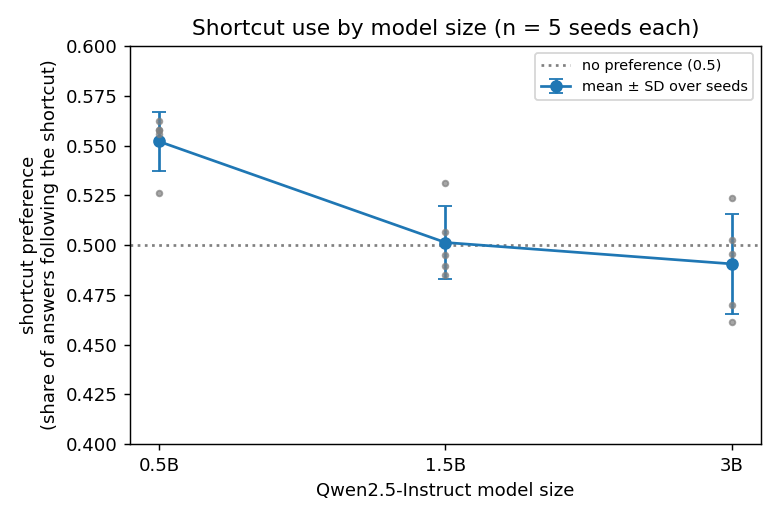
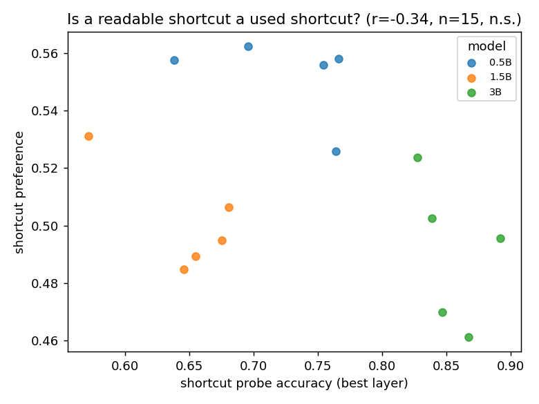
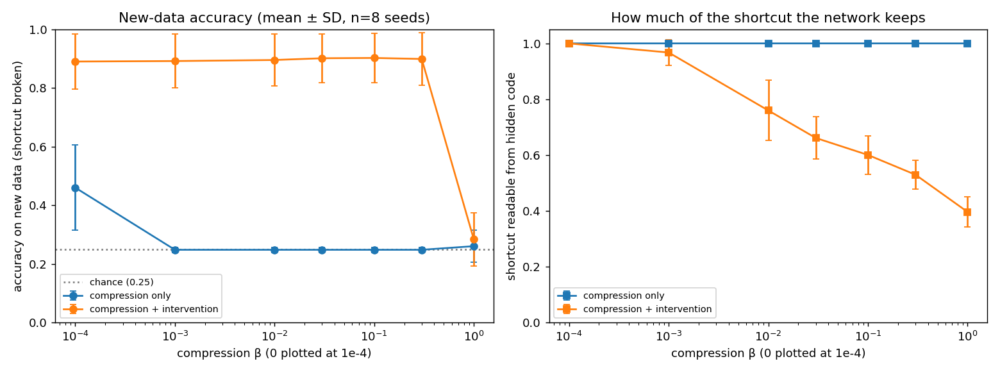

# Rule or shortcut: can compression or probes tell them apart?

Nurkyz Ydyrysova · September 2026 · Code and data: https://github.com/nurkyzaz/AGI/tree/main/ibrg_llm

How this was done: [CONFIRM: Experiments designed by Nurkyz Ydyrysova; code written and run with an AI coding agent under her direction; results checked by her.]

## 1. Question

I set out to test whether the information bottleneck (IB: compress an input, keep what predicts the label) behaves like the renormalization group (RG: coarse-graining in physics) in neural networks. My first setup, ARC-style grids as text (`step0.py`), failed: Qwen2.5-3B could not do the task. So I asked a question the IB side alone can address: when a network can use the **rule** (the label's cause) or a **shortcut** (a cue that predicts the label in training only), can compression or probes tell them apart? **The RG side was not tested.**

## 2. Setup

- **Language models:** Qwen2.5-Instruct 0.5B, 1.5B, 3B; in-context classification; 5 seeds each, 160 items per seed where rule and shortcut disagree. **Shortcut preference** = share of answers following the shortcut (0.5 = no preference).
- **Probes:** linear classifiers on frozen activations. **Ablation:** project the shortcut directions out of one layer, against a same-size random direction.
- **Small network from scratch:** variational IB; β sets how much the hidden code keeps. Test data breaks the shortcut (out-of-distribution, OOD). 4 classes (chance 0.25), 8 seeds.
- **Intervention:** training data where the shortcut no longer matches the label.

## 3. Results

Mean ± SD over seeds, from `out/stats.txt`.

| Claim | Number | n | Status |
|---|---|---|---|
| 0.5B leans toward the shortcut; 1.5B, 3B show no net preference | 0.552 ± 0.015; 0.501 ± 0.019; 0.491 ± 0.025 | 5 each | supported |
| Shortcut use falls with size | 0.5B→1.5B p = 0.002; 1.5B→3B p = 0.47 (Welch) | 5 vs 5 | only first step |
| Removing shortcut directions lowers shortcut use | 3B +0.018 ± 0.023 vs random +0.001 (4/5 seeds; paired t = 1.69, df = 4, p = 0.17); 1.5B −0.016; 0.5B +0.003 | 5 each | inconclusive |
| Layer sweep (3B) | best layer 16, 26, 12 of 36; best-of-36 vs one random direction | 3 | inconclusive (biased) |
| Rule-minus-shortcut probe gap tracks rule-following | pooled r = 0.68 (p = 0.005); within model 0.25, 0.32, 0.08 | 15 | between sizes only |
| Shortcut readability tracks shortcut use | pooled r = −0.34 (p = 0.22); within model −0.44, −0.72, −0.43 | 15 | null |
| Compression removes a noise feature | readability 0.63 → 0.00; rule kept 0.80–0.90; best OOD 0.73 (at β = 0) | 8 | removes noise; no OOD gain |
| Compression fixes a cheap shortcut | OOD 0.46 (β = 0), 0.248 (β = 0.001–0.3), 0.26 (β = 1); shortcut kept 1.0 | 8 | null |
| Intervention fixes it | OOD 0.89–0.90 (β ≤ 0.3); 0.28 (β = 1) | 8 | supported |
| Rule and shortcut directions match on training data, differ across environments | β = 0: 1.00 vs 1.00 (AUC 0.48); 0.83 vs 0.73. β ≥ 0.001: about 0.6 vs 0.5 | 5 | clear only at β = 0 |

## 4. What this shows and doesn't

- **Being linearly readable is not evidence of being used.** No evidence that how readable a shortcut is tracks how much the model uses it (r = −0.34, n = 15, not significant; negative within every model). Probe-based monitors need causal checks.
- Any compression drops OOD accuracy to chance (0.25); intervention restores it to about 0.90. This is a controlled demonstration of a known point: minimal sufficient statistics on one distribution cannot separate a causal feature from an equally predictive spurious one (Arjovsky et al. 2019, IRM; Causal Information Bottleneck, arXiv 2410.00535).
- Causal evidence in the language models is weak: suggestive in 3B (4 of 5 seeds), not significant at n = 5, absent in smaller models.

## 5. Not tested: IB = RG

Next steps, not claims. A real test needs: (a) reproducing the known result where RG is known, e.g. RSMI on the 2D Ising model (Koch-Janusz & Ringel 2018; Gordon et al. 2021); (b) a notion of locality and scale in a network; (c) a test of whether repeated IB coarse-graining composes into a flow with relevant and irrelevant directions.

## 6. Limitations

- 5 seeds (3 for the layer sweep), one synthetic task family, models ≤ 3B.
- Compression results come from a small network, not a language model.
- The probe-gap correlation exists only between model sizes.

## 7. Reproduce

`python -m ibrg_llm.stats` (numbers) and `python -m ibrg_llm.aggregate` (figures), CPU-only from `out/*.json`. Experiments: `runner.py`, `ablsweep.py`, `vib.py`, `boundary.py`, `crit.py`.
